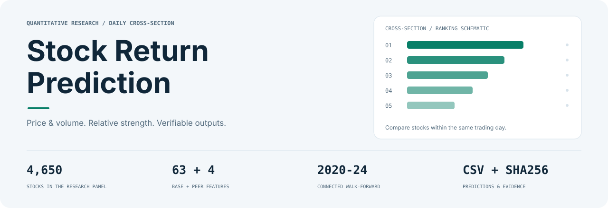
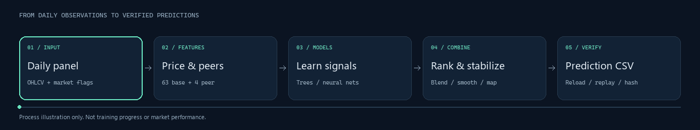
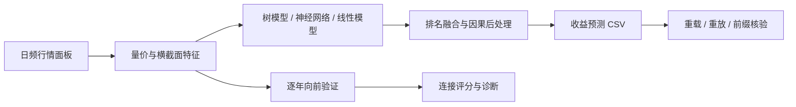
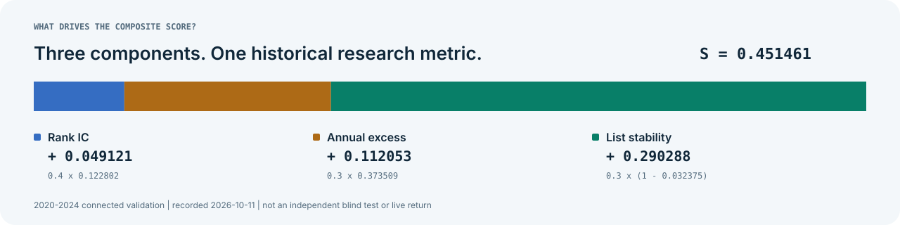

<div align="center">

<picture>
  <source media="(prefers-color-scheme: dark)" srcset="docs/assets/hero-dark.svg">
  <source media="(prefers-color-scheme: light)" srcset="docs/assets/hero-light.svg">
  
</picture>

<h1>Stock Return Prediction</h1>

<p><strong>从每日量价数据，到数千只股票的相对收益预测。</strong></p>
<p>A 股横截面建模研究 · 树模型与神经网络 · 连续向前验证 · 预测产物核验</p>

[](requirements.txt) [](docs/DATA_GUIDE.md) [](docs/METHODS.md) [](docs/METHODS.md#连续向前验证) [](docs/RESULTS.md)

<p>
<a href="#项目亮点">项目亮点</a> ·
<a href="#快速开始">快速开始</a> ·
<a href="docs/METHODS.md">方法详解</a> ·
<a href="docs/RESULTS.md">实验结果</a> ·
<a href="docs/README.md">完整文档</a>
</p>

</div>

## 每天为 4,650 只股票建立一份相对收益排序

本项目使用股票的日频开高低收、成交量、成交金额和涨跌停标记，学习未来一天的收益信号。研究同时关注三个问题：预测能否正确排序、排名靠前的股票是否跑赢同日股票池、头部名单能否保持稳定。

仓库记录了从单模型到多模型组合的实现：量价特征计算、同伴特征、树模型与神经网络、排名融合、因果平滑、收益映射，以及模型重载和预测文件复算。你可以从固定配方的基准入口开始，也可以沿着冻结源码和哈希记录阅读复杂方案的演进。

| 数据规模 | 验证跨度 | 预测输出 | 实验记录 |
|:---:|:---:|:---:|:---:|
| **790 万**训练样本 | **1,212** 个验证交易日 | **160 万**条预测 | **18,959** 条评分记录 |
| 2018—2024 年，4,650 只股票 | 2020—2024 年连续连接 | 344 日 × 4,650 只股票 | 含对照、复用与重复配置[^records] |

## 项目亮点

<table>
<tr>
<td width="50%" valign="top">
<h3>01 · 从量价到横截面</h3>
<p>63 项基础特征覆盖 K 线、趋势、波动、流动性和同日相对位置；固定集成基准再加入 4 项同伴特征。Qlib 提供所选 Alpha158 公式定义，Polars 在项目数据上计算。</p>
</td>
<td width="50%" valign="top">
<h3>02 · 比较完整预测流程</h3>
<p>研究覆盖 LightGBM、XGBoost、CatBoost、MLP、GRU、Transformer 和线性残差方法，进一步考察排名融合、头部保护、名单留存与收益校准。</p>
</td>
</tr>
<tr>
<td valign="top">
<h3>03 · 沿时间向前验证</h3>
<p>逐年生成样本外预测，再连接成同一验证区间。预处理、标签成熟和年度交界处的换手都有明确口径，便于理解各个分数从何而来。</p>
</td>
<td valign="top">
<h3>04 · 让产物能够核对</h3>
<p>保留配置、源码快照、原生模型哈希、重载结果、独立推理、CSV 重放与前缀一致性记录，让读者能从结论追到文件和执行证据。</p>
</td>
</tr>
</table>

## 一条从数据到预测的研究流水线



动画展示处理顺序，不表示训练进度或真实市场表现。[查看静态流程图](docs/assets/pipeline.svg)。



输入以 `(ts_code, trade_date)` 标识股票与日期；输出统一为三列：

```csv
ts_code,trade_date,pred
```

`pred` 的含义随路线而有所区别：直接回归基线输出模型预测的收益率；固定 XGBoost 基准对排名作仿射变换；复杂研究方案使用对应的训练期映射。读取文件前，应先确认它来自哪条路线。

## 两条值得先读的路线

| | 直接收益基线 | 多模型集成研究 |
|---|---|---|
| 核心设计 | 63 特征 → 单个 LightGBM → 一天收益 | 多种信号 → 排名融合 → 稳定性处理 → 收益映射 |
| 最终推理模型 | 1 个；另保留 5 个年度验证模型 | 37 个原生模型，具有不同分工 |
| 阅读价值 | 理解标签、时间边界和完整验证流程 | 研究信号互补、成员选择与排序的相互影响 |
| 训练期连接综合分 | `0.3387488124` | `0.4514612197` |
| 详细入口 | [固定 LightGBM 基线](docs/TRAIN_ONLY_BASELINE143.md) | [模型与验证](docs/METHODS.md#多模型研究方案) |

另有便于从根目录运行的 **67 特征、16 种子 XGBoost 固定基准**。它包含一个 LightGBM 辅助模型；下面的快速开始运行这条路线。

## 快速开始

### 1. 获取代码并准备环境

```powershell
git clone https://github.com/Zagadka-3906/stock-return-prediction.git
cd stock-return-prediction
python -m venv .venv
.\.venv\Scripts\python.exe -m pip install -r requirements.txt
```

以上为 Windows / PowerShell 命令。Python 3.12 是原研究环境；依赖版本见 [requirements.txt](requirements.txt)。Linux / macOS 的对应命令见[安装与运行](docs/GETTING_STARTED.md)。

### 2. 放置原始数据

```text
data/raw/
├── 训练集.csv
└── 测试集_X.csv
```

原始数据需要自行取得，Git 源码克隆不包含这些 CSV。字段要求、缺失值和面板结构见[数据指南](docs/DATA_GUIDE.md)。

### 3. 构建特征、训练并输出预测

```powershell
.\.venv\Scripts\python.exe -B -X utf8 run.py features
.\.venv\Scripts\python.exe -B -X utf8 train_ensemble.py --threads 8 --device cpu
.\.venv\Scripts\python.exe -B -X utf8 predict.py --threads 8 --output outputs/baseline_predictions.csv
```

预测入口会检查列名、记录数、股票与日期顺序、重复主键和有限值。模型保存在 `models/ensemble/`，输出在 `outputs/baseline_predictions.csv`。

> [!NOTE]
> 这些命令运行固定 XGBoost 基准。37 模型研究方案依赖冻结协议、保存权重和父方案；原始数据与权重 ZIP 均未作为 GitHub Release 提供。详见[复现指南](docs/REPRODUCIBILITY.md)。

## 怎样衡量预测质量

项目沿用既有评分器，将排序、头部超额与名单稳定性放在一起观察：

```math
S = 0.4\,\overline{\mathrm{RankIC}}
  + 0.3\,R_{\mathrm{excess,annual}}
  + 0.3\,(1-\overline{\mathrm{turnover}})
```

这里的换手是相邻 Top 10% 股票集合的 **Jaccard 距离**，年化收益是日均收益乘 252。基准股票池为同日过滤后的股票平均，不是指数。具体过滤与样本门槛见[评分定义](docs/METHODS.md#评分定义)。

<picture>
  <source media="(prefers-color-scheme: dark)" srcset="docs/assets/score-dark.svg">
  
</picture>

37 模型方案在 **2020—2024 年训练期连接验证**中记录的指标为：

| Rank IC 均值 | Top 10% 年化超额 | 相邻名单平均换手 | 综合分 S |
|---:|---:|---:|---:|
| `0.122802` | `37.3509%` | `3.2375%` | `0.45146122` |

稳定性项对总分贡献较大，阅读结果时需要同时查看三项原始指标。完整八项指标、基线对照、文件哈希和归档入口见[结果与产物](docs/RESULTS.md)。

> [!IMPORTANT]
> 上述为历史研究验证结果。验证区间被反复用于研究，且旧集成路线曾受测试期结果反馈，不能将这些数字解释为独立盲测或实盘收益。已知限制与更正记录见[研究边界](docs/SELECTION_COMPLIANCE.md)。[^snapshot]

## 代码地图

```text
stock-return-prediction/
├── src/                 特征、同伴信号、集成、评分和后处理
├── config/              固定基准的特征顺序与训练配方
├── experiments/         早期模型与特征研究
├── analysis/            后续研究、冻结、推理与核验脚本
├── tests/               评分与预测相关检查
├── results/             指标、轮次摘要与结果索引
├── validation_sync/     冻结源码、协议、哈希与执行证据
├── docs/                使用、方法、数据与复现文档
├── tools/               归档查询与文档工具
├── run.py               基础特征与早期 LightGBM 流程
├── train_ensemble.py    固定 XGBoost 集成训练
├── predict.py           已保存集成的推理入口
└── evaluate.py          原始评分实现
```

根目录入口与 `src/` 适合先读；历史研究脚本通常依赖特定快照和本机路径。更详细的职责与文件关系见[仓库导航](docs/REPOSITORY_GUIDE.md)。

## 继续探索

| 你想做什么 | 从这里开始 |
|---|---|
| 了解动机、适用范围和项目定位 | [关于项目](ABOUT.md) |
| 跑通固定基准 | [安装与运行](docs/GETTING_STARTED.md) |
| 换成自己的股票数据 | [数据指南](docs/DATA_GUIDE.md) |
| 理解模块与数据流 | [系统架构](docs/ARCHITECTURE.md) |
| 阅读特征、模型与时间验证方法 | [方法详解](docs/METHODS.md) |
| 核对指标或复算已有文件 | [结果与产物](docs/RESULTS.md) · [复现指南](docs/REPRODUCIBILITY.md) |
| 提出改进或补充文档 | [贡献指南](CONTRIBUTING.md) |

<details>
<summary><strong>常见问题：能一键运行吗？数据和模型在哪？可以用于交易吗？</strong></summary>

准备数据与依赖后，根目录的固定基准可按上面的顺序运行。复杂历史方案还需要原始权重、冻结配置和路径依赖。普通 Git 克隆包含研究源码与记录，数据和完整模型包需另行准备。

项目目前是离线建模研究，没有行情接入、券商接口、完整撮合或生产部署流程。评分中的收益与集合换手也不包含完整的执行成本模型。

更多问题见 [FAQ](docs/FAQ.md)。

</details>

[^records]: 18,959 是评分实例数，包含正式登记的 17,753 项与新增已完成原始评分 1,206 项，不能当成独立模型数量。
[^snapshot]: 本文于 2026-11-03 重写；实验数字来自 2026-10-11 的既有记录。本次文档更新没有重新训练或刷新实验成绩。
