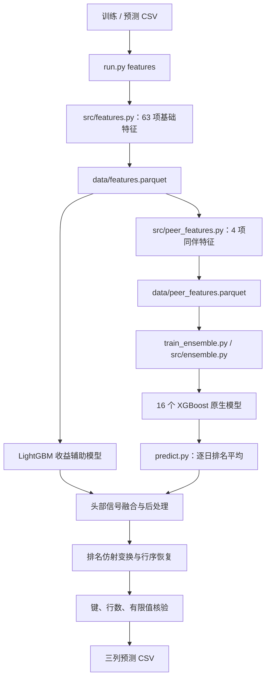

# 系统架构

项目由通用基准代码和历史研究流程组成。通用代码负责特征、集成、评分与后处理；研究流程在这些基础上保存具体实验的配置、冻结源码和执行证据。理解二者的关系，有助于选择正确的运行入口。

## 固定 XGBoost 基准的数据流

## 通用模块

| 模块 | 职责 | 关键关系 |
|---|---|---|
| `src/features.py` | Qlib 公式对照、量价与横截面特征、Parquet 缓存 | `run.py features` 调用 |
| `src/peer_features.py` | 按特征分组形成同伴收益及滞后、偏离信号 | 基础 63 特征扩展为固定模型的 67 特征 |
| `src/ensemble.py` | 配方校验、模型训练保存、日排名平均、最终推理 | 根目录集成训练与预测入口共用 |
| `src/scoring.py` | 面板结构、逐日排名、平滑、名单留存和评分辅助 | 与原评分器保持口径对照 |
| `src/postprocessing.py` | 收益辅助信号的融合模式与受保护区域处理 | 固定基准使用 `top_only` 模式 |
| `src/pooled_target.py` | 收益辅助模型的训练目标处理 | 使用训练数据计算目标统计量 |
| `src/research_stats.py` | 研究统计辅助逻辑 | 历史实验复用 |

原始评分定义在 `evaluate.py`；`src/scoring.py` 是面向完整面板的辅助实现。修改快速评分路径时，需要与原始实现对照，不能只验证自身的一致性。

## 三类运行入口

| 入口 | 适用场景 | 输出性质 |
|---|---|---|
| `run.py` | 基础特征与早期 LightGBM 实验 | 其 `all` 流程使用 2022—2024 验证 |
| `train_ensemble.py` + `predict.py` | 固定 XGBoost 集成的训练与模型重载 | 16 种子、67 特征、LightGBM 辅助模型 |
| `analysis/` 中指定版本脚本 | 基线143或特定多模型历史方案 | 依赖各自协议、权重与冻结环境 |

这三类入口有共享概念，但并不共享全部配置和产物。根目录命令不会自动找到或重建37模型历史方案。

## 研究方案的产物链

每个阶段回答不同问题。分数表示某个输出在给定样本上的表现；模型重载与 CSV 重放检查计算是否可复现；前缀核验检查增加后续行情是否改变前段输出；研究来源记录则说明实验选择是否受过外部反馈。一个阶段成功，不自动证明其他阶段完成。

## 历史依赖为何比较复杂

后续集成方案可能保留父方案的名单逻辑，只对局部排序增加新信号；因此它依赖的不止新增模型，还包括父方案、词表、收益映射和后处理状态。冻结脚本中的 D/E 盘路径是原执行环境的一部分，迁移时应先建立完整依赖清单。

`validation_sync/` 保存这些快照，便于按原版本查看。已清理的权重或缓存仍可能出现在旧 manifest 中；当前文件可用性应结合[归档维护](REPOSITORY_CLEANUP.md)解释。

[方法详解](METHODS.md) · [仓库导航](REPOSITORY_GUIDE.md) · [复现指南](REPRODUCIBILITY.md)
