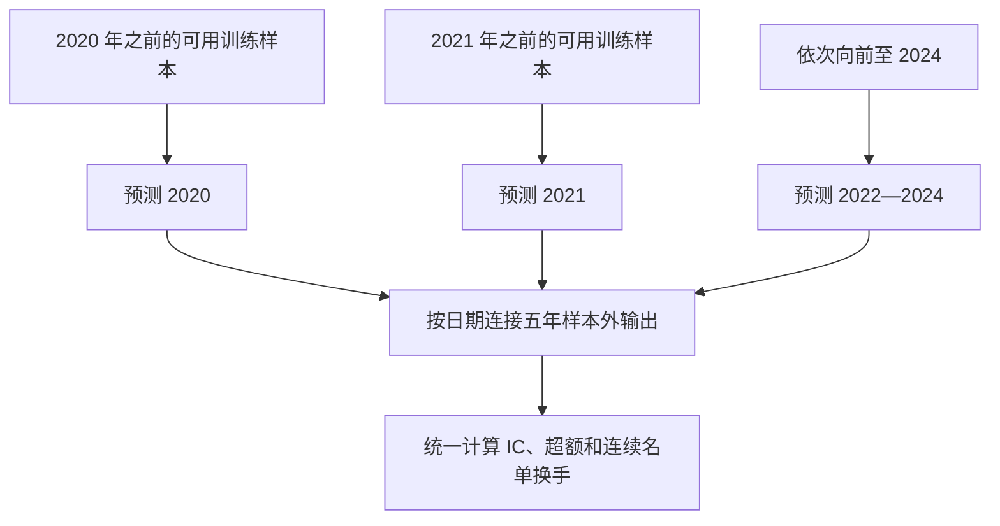

# 方法详解

项目将一天收益预测与同日横截面排序结合起来，比较从输入数据到最终 CSV 的完整流程。模型的原始相关性、头部名单的收益与名单的稳定性，分别由不同指标衡量。

## 预测时点与目标

输入为当日完整行情与此前历史，预测时点位于当日行情可用之后。训练目标 `y_ret_1d` 沿用原数据定义，不在特征计算中自行改成另一种收益口径。

直接收益基线学习标签本身；固定 XGBoost 基准学习日内居中的收益排名 `y_rank`；部分研究模型学习较长期收益、排名、Top 分类或残差。辅助目标最终仍服务于一天收益与排序任务，不能把标签期限直接当成组合持有期。

## 特征体系

### 63 项基础特征

基础特征实现位于 [src/features.py](../src/features.py)。Qlib 的 Alpha158 配置提供所采用子集的公式定义，由 Polars 在本项目面板上计算；本项目没有使用完整158项特征。

| 类别 | 代表内容 | 用途 |
|---|---|---|
| K 线与相对价格 | 实体、振幅、上下影线、开高低相对收盘价 | 表示当日价格形态 |
| 趋势与波动 | 5 / 10 / 20 / 60 日 ROC、均线、价格标准差 | 表示历史路径与波动状态 |
| 量额与流动性 | 成交量均值与标准差、量额比例、对数规模、ILLIQ | 表示活跃程度和流动性差异 |
| 自定义历史信号 | 多窗口收益、距历史高点、涨停次数、收益波动 | 补充历史变化 |
| 横截面位置 | 收益、振幅、量额、波动等同日排名 | 对比同一天股票的相对位置 |
| 市场状态 | 涨停、跌停标记 | 保留原始交易状态信息 |

滚动和滞后按股票分组，横截面排名按日期分组。使用当日收盘行情符合本项目的预测时点；如果改成开盘前预测，必须重新定义可见字段和特征滞后。

### 4 项同伴特征

[src/peer_features.py](../src/peer_features.py) 按当日 `RET20` 与 `STD20` 的五分位组合形成特征格子，计算排除自身后的同伴当日收益，再生成四项输入：

| 名称 | 含义 |
|---|---|
| `PEER_RET1` | 特征格子内其他股票的当日平均收益 |
| `PEER_RET1_L1` | 该股票同伴信号的一日滞后 |
| `PEER_RET3` | 同伴信号的三日滚动均值 |
| `PEER_DEV` | 自身当日收益减同伴收益 |

这里的同伴由量价特征定义，并非行业分类。后续部分网络使用121项特征与16维股票身份嵌入，其实际维度、顺序和词表以对应协议为准。

## 固定模型路线

| 路线 | 主要配置 | 输出 |
|---|---|---|
| LightGBM 基线143 | 63 特征、31叶、180轮、学习率0.05、种子2026 | 原生一天收益回归，无额外后处理 |
| 根目录 XGBoost 基准 | 67 特征、16种子、360棵树、深度7、学习率0.025 | 日排名平均、辅助信号与稳定性处理后作仿射变换 |
| 根目录早期 LightGBM | `run.py` 中的训练与年度验证流程 | 与后续基线和复杂方案分别保存 |

固定 XGBoost 配方见 [config/ensemble.json](../config/ensemble.json)。其辅助 LightGBM 模型学习训练期裁剪、居中并按 pooled RMS 处理的收益目标，在 `top_only` 模式下以0.25权重参与受保护上部区域的排序。基准平滑参数为0.9，名单留存加分为0.3。

这里的16是 XGBoost 种子成员数量，另有一个辅助模型。37模型则指复杂研究方案保存的不同原生模型，二者不能混用。

## 多模型研究方案

探索方向包括 LightGBM、XGBoost、CatBoost 排序模型、MLP、GRU、Transformer、Ridge、随机特征、条件残差与分位数方法。尝试过一种方法，并不表示它被最终采用。

后续流程将信号分成不同作用：一部分决定头部成员与名单留存，另一部分改善组内或下部排序。收益映射与后处理也属于完整方案，比较时应评估其最终输出。

2026-10-11 已封装的37模型方案继承第183轮父方案，加入60日与120日股票身份网络的一致性信号。新增信号采用最近252个交易日的训练窗口，参数为：

```json
{
  "weight": 0.04,
  "disagreement_penalty": 0.75,
  "protect_fraction": 0.15
}
```

在有效且非涨停的股票池内，保护父方案前15%区域，只在其下方重新分配原预测值；每日预测值集合保留。该次增益主要来自 IC，保存的 Top 年化超额与平均换手没有变化，不能写成头部收益或稳定性改善。

## 连续向前验证

后续主要记录使用2020—2024逐年向前验证：预测某一年时，只用该年开始前已经可获得的训练信息。五段样本外输出按日期连接，在整个1,212交易日、5,635,800行的面板上一次计算指标。



年度交界处继续计算名单换手，不重置成一组新的首日。逐年指标和年度均分用于诊断，不能替代连接区间的总分。根目录早期 LightGBM 的2022—2024验证则属于另一范围。

### 标签成熟

H日辅助标签汇总从 t 到 t+H−1 的一天收益标签，只有完整标签已经可用的样本才能进入训练。训练截止日期不仅要检查特征观测日，也要检查标签结束日；跨越截止边界的标签必须排除。

预处理、股票词表与收益映射按各自训练窗口拟合。60日和120日目标具有不同成熟样本范围，不能直接假设共享同一批可训练样本。

## 评分定义

评分由 [evaluate.py](../evaluate.py) 定义，保存八项诊断，其中三项进入总分：

```math
S=0.4\,IC_{\mathrm{mean}}+0.3\,R_{\mathrm{excess,annual}}+0.3(1-T_{\mathrm{mean}})
```

| 分量 | 计算 | 过滤与门槛 |
|---|---|---|
| `ic_mean` | 每日预测与一天收益的 Spearman 相关，再取均值 | 去掉缺失标签；不额外去掉涨停；少于30行跳过 |
| `annual_excess` | 预测前10%股票的平均收益减同日股票池均值，再按日均乘252 | 去掉涨停与缺失标签；少于100行跳过 |
| `mean_turnover` | 相邻 Top 10%股票集合的 Jaccard 距离均值 | 去掉涨停；不额外去掉缺失标签；少于100行时重置前一集合 |

```math
T_t=1-\frac{|A_t\cap A_{t-1}|}{|A_t\cup A_{t-1}|}
```

Top组人数为 `max(n // 10, 1)`。首个有效名单不产生相邻换手观测。IC标准差使用样本标准差，ICIR为均值除标准差。年化采用算术日均乘252，既不是复利净值，也不是扣费收益。

实际评分调用可写为：

```python
from evaluate import evaluate

metrics = evaluate(
    _submission_path="validation/my_run/submission.csv",
    _data_dir="validation/my_run/scoring_data",
)
print(metrics)
```

目录中应放与该验证输出对应的 `测试集_X.csv` 和 `测试集_Y.csv`。这两个文件名由原始评分器固定；训练内部评分时内容来自训练期留出样本。评分器按主键做内连接，调用前还需独立检查覆盖和重复键，不能仅凭评分成功认定预测文件完整。

## 核验能证明什么

| 检查 | 回答的问题 |
|---|---|
| 原生模型重载 | 保存文件重载后输出是否一致 |
| 独立全量推理 | 另一条计算路径能否复算相同预测 |
| CSV 字节重放 | 最终文件能否逐字节重建 |
| 80日冷启动前缀 | 只给前80日行情，前段特征与预测是否一致 |
| SHA256 与 manifest | 当前文件是否与指定快照相同 |

前缀检查覆盖其指定范围，并不自动证明所有特征、所有时期和研究选择均无未来信息。历史测试反馈与多轮搜索的解释集中在[研究边界](SELECTION_COMPLIANCE.md)。
