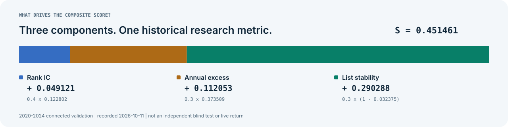

# 结果与产物

本页汇总2026-10-11已有的研究结果，文档于2026-11-03更新。所有下表分数均为训练期逐年向前预测连接后的结果；本次文档更新没有重训、重评分或新增市场表现。

## 主要路线对照

| 路线 | Rank IC 均值 | Top年化超额 | 平均集合换手 | 综合 S |
|---|---:|---:|---:|---:|
| 单模型直接收益基线143 | 0.085973 | 49.1544% | 47.7011% | 0.3387488124 |
| 37模型集成研究方案 | 0.122802 | 37.3509% | 3.2375% | 0.4514612197 |

这个对照展示了指标之间的取舍：单模型记录的头部超额更高，集成方案记录的相关性与名单稳定性更高。由于评分包含 `0.3 × (1 − 换手)`，稳定性变化对总分影响明显。两条路线的研究来源和选择过程也不同，不能只据总分推出独立盲测上的优劣。

### 37模型方案的分量贡献

| 分量 | 原始值 | 权重 | 对 S 的贡献 |
|---|---:|---:|---:|
| Rank IC | 0.12280208457197295 | 0.4 | 0.0491208338 |
| 年化超额 | 0.3735093425702569 | 0.3 | 0.1120528028 |
| 名单稳定性 `1 − turnover` | 0.9676252768946512 | 0.3 | 0.2902875831 |
| **合计** | | | **0.4514612197** |



## 八项完整指标

| 指标 | 单模型基线143 | 37模型研究方案 |
|---|---:|---:|
| `ic_mean` | 0.08597256023334594 | 0.12280208457197295 |
| `ic_std` | 0.10432119270733467 | 0.11111633330974156 |
| `icir` | 0.8241140462660885 | 1.1051668185419405 |
| `ic_positive_ratio` | 0.8283828382838284 | 0.8960396039603961 |
| `annual_excess` | 0.49154377285007644 | 0.3735093425702569 |
| `top1_annual_ret` | 0.5170375269103339 | 0.39900309663051436 |
| `mean_turnover` | 0.4770111450480508 | 0.032374723105348766 |
| `final_score` | 0.33874881243394606 | 0.4514612196682616 |

基线来源为 [results/train_only_baseline143_v1_20261011.json](../results/train_only_baseline143_v1_20261011.json)，集成来源为[结果快照](latest_results.json)及其绑定的交付记录。ICIR、正IC占比与绝对收益只作诊断，不额外加入 S。

## 37模型方案的邻近版本

| 方案 | 连接 S | 保存状态 |
|---|---:|---|
| 60/120日一致性、15%保护区，候选101 | 0.4514612196682616 | 完整推理与封装通过，正式完整榜登记待完成 |
| 60/120日一致性、20%保护区，候选85 | 0.4514555940046018 | 完整核验的备份 |
| 第189轮历史交付 | 0.4514130257498636 | 正式完整榜登记已完成，36个原生模型 |

候选101相对备份的微幅变化主要来自IC，记录中的年化超额与平均换手相同。候选编号、正式轮次和模型数量分别表示不同含义。

## 预测文件与模型包

两条主要路线的已记录预测都覆盖344个交易日、4,650只股票、1,599,600行，列名为 `ts_code,trade_date,pred`。它们对应不同模型，文件不能相互替换后继续沿用旧指标或哈希。

<details>
<summary><strong>37模型预测与压缩包 SHA256</strong></summary>

```text
submission.csv
18c4c67c7b457eabb3e8c89048df2ae67bc64197b77d0d9e8225ef8a9399f438

赛题五_高分方案_S0.45146122_20261011.zip
d3928b57be66ee0747eb0751c22923ff804e2496b32568beb9643594c80ee6d5
```

ZIP 为160,925,612字节，约153.47 MiB，包含16,600个条目、37个原生模型、冻结源码与配置证据。条目已有逐一SHA256核验记录。压缩包由维护者本地保存，未发布为GitHub Release附件。

</details>

<details>
<summary><strong>直接收益基线143的预测与最终模型 SHA256</strong></summary>

```text
submission.csv
ce281b9100807b7b61b938f86517a0aaa996b19b6d5edd0d0ffdcbd31a3c397f

model_final.txt
fda8d140ee3e686266f9cd3fcad446949effcdc3d33cc99b461c048a37c8151f
```

该路线完成5次年度验证拟合和1次最终拟合，最终预测只使用1个模型。详细设计与复现条件见[固定基线](TRAIN_ONLY_BASELINE143.md)。

</details>

取得文件后，可在PowerShell执行：

```powershell
Get-FileHash -Algorithm SHA256 -LiteralPath 'submission.csv'
```

Linux / macOS 可用标准库核验：

```bash
python -c "import hashlib; from pathlib import Path; print(hashlib.file_digest(Path('submission.csv').open('rb'), 'sha256').hexdigest())"
```

模型包不是一个跨机器即解压即重训的安装包：原始数据、Python环境与父方案依赖需单独恢复。[复现指南](REPRODUCIBILITY.md)说明了各层次的复现要求。

## 评分明细与完整榜

训练评分明细共 **18,959** 项，其中正式评分实例17,753项、新增已完成原始实例1,206项。该数量包含复用、对照和重复，不是独立模型数量。正式完整榜完成到第191轮；第192轮登记中断，文件存在不等于完成。

- [全部训练验证分数明细 CSV.gz](../validation_sync/Actual_fraction101_complete_bundle_catalog_v7_and_discarded_weights_cleanup137_20261011/external_metadata/d4e902ebc06db7788115eb9374ede012f66b203d3cc60ec44bac55cdc9e7e938_全部训练验证分数明细.csv.gz)
- [历史过滤明细 CSV.gz](../validation_sync/Actual_fraction101_complete_bundle_catalog_v7_and_discarded_weights_cleanup137_20261011/external_metadata/a77376323e14d93bb9ab523fbb5931cd6169d2d10aa0f6ce9df0b9006cad4fdd_排除已知非因果限制后的训练分数明细.csv.gz)
- [评分目录位置与核验指针](../validation_sync/Actual_fraction101_complete_bundle_catalog_v7_and_discarded_weights_cleanup137_20261011/analysis/complete191_plus_completed_raw_TRAIN_score_catalog_location_v7_20261011.json)
- [第191轮正式归档](../validation_sync/round191/)

gzip 解压后按 CSV 阅读，同时保留 `known_restriction`、`qualification`、`source` 和哈希等字段。历史过滤表只按当时的数值限制过滤，没有排除后来确认的研究选择反馈。

## 从指标追到证据

| 证据 | 入口 |
|---|---|
| 37模型源码与提交CSV归档 | [候选源码快照](../validation_sync/Actual_consensusFraction101_complete_candidate_sources_and_submission_v1_20261011/) |
| ZIP核验、评分目录与清理记录 | [完整包与目录归档](../validation_sync/Actual_fraction101_complete_bundle_catalog_v7_and_discarded_weights_cleanup137_20261011/) |
| 单模型基线的冻结源码与记录 | [基线143归档](../validation_sync/TRAIN_only_baseline143_v1_20261011/) |
| 程序可读摘要 | [latest_results.json](latest_results.json) |
| 历史测试反馈与两次直接评分复核 | [更正证据归档](../validation_sync/Actual_selection_compliance142_correction_v1_20261011/) |

候选源码快照提交为 `59c2553fcd61371f8f55f26b16aa333d8729071f`，模型包与目录核验提交为 `363b04accad09d792a53de06f0a3cde3dba11146`。当前main可以继续前进，核验历史内容时应使用对应提交。

## 结果应如何使用

这些结果适合研究模型、组合和后处理对统一指标的影响。验证区间经历多轮搜索，旧集成路线也受过测试期结果反馈，因此不能宣称独立盲测有效；现有结果没有提供实盘成交、完整成本或市场冲击验证。详细历史与可支持的结论见[研究边界](SELECTION_COMPLIANCE.md)。
